> - 시퀀스 다이어그램에서 Controller, Repository와 같은 세부 사항은 생략하였습니다.  
> - Facade에서 도메인 간 협력을 나타내었습니다.

# 상품 목록 조회

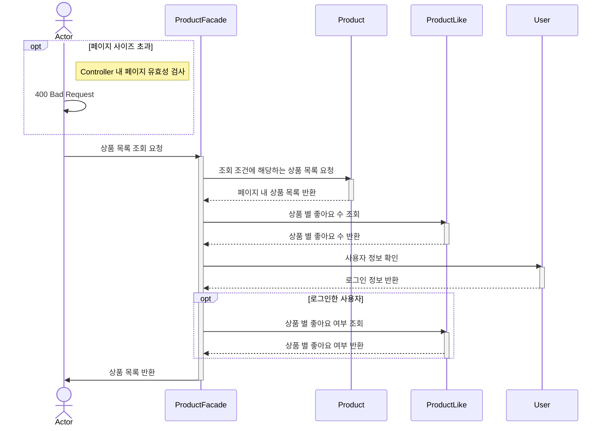

# 상품 상세

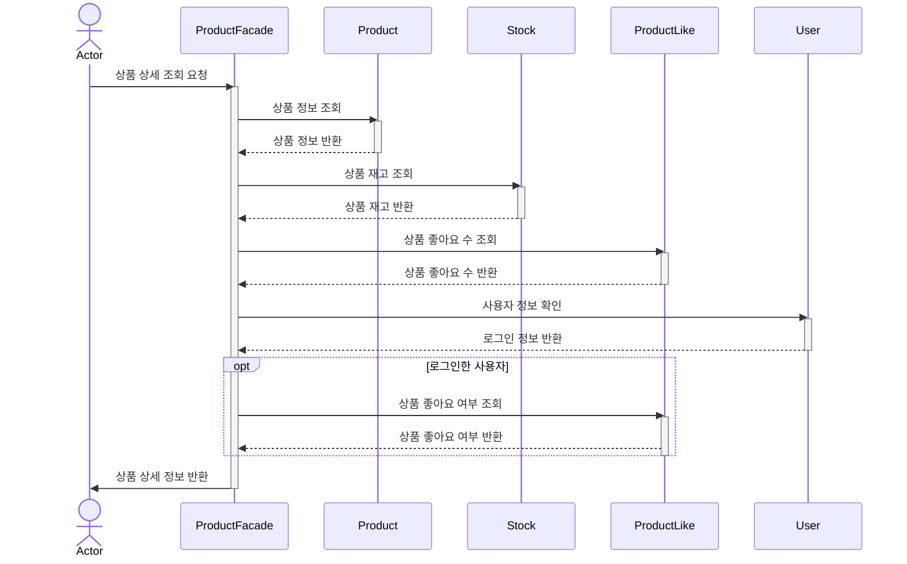

# 브랜드 조회

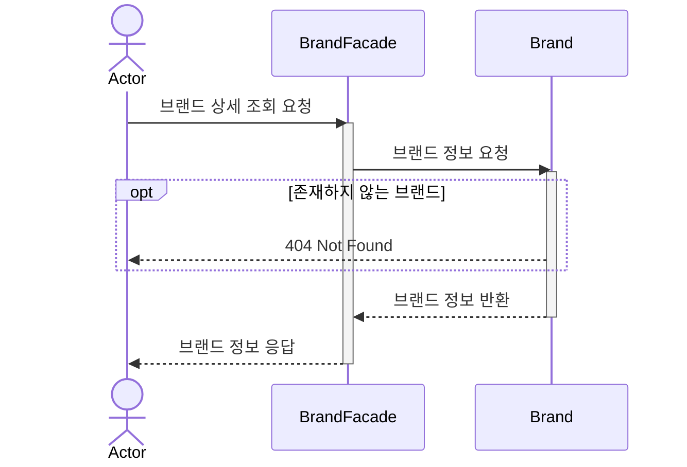

# 상품 좋아요 등록/취소

## 좋아요 등록

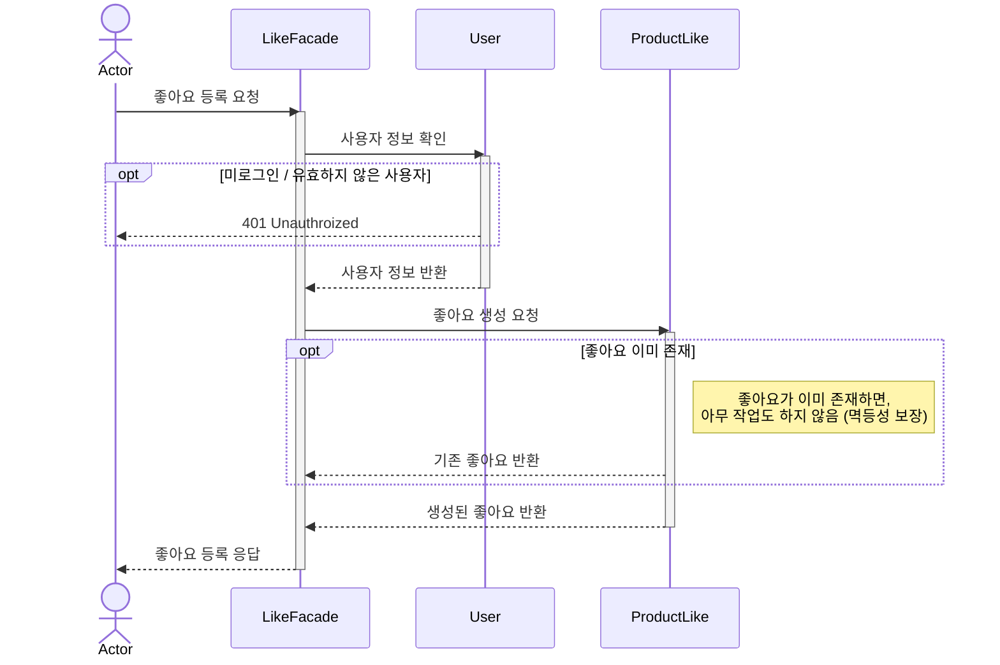

## 좋아요 취소

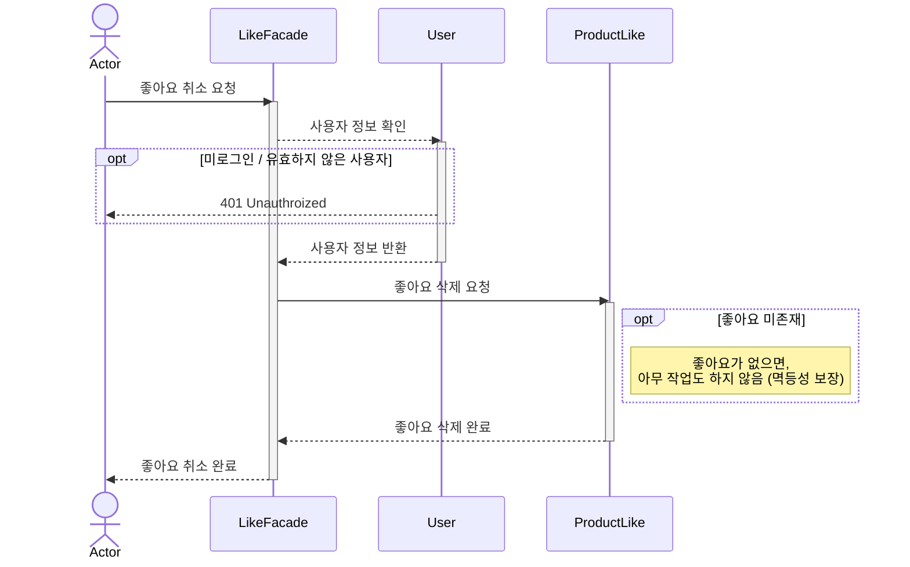

# 내가 좋아요한 상품 목록 조회

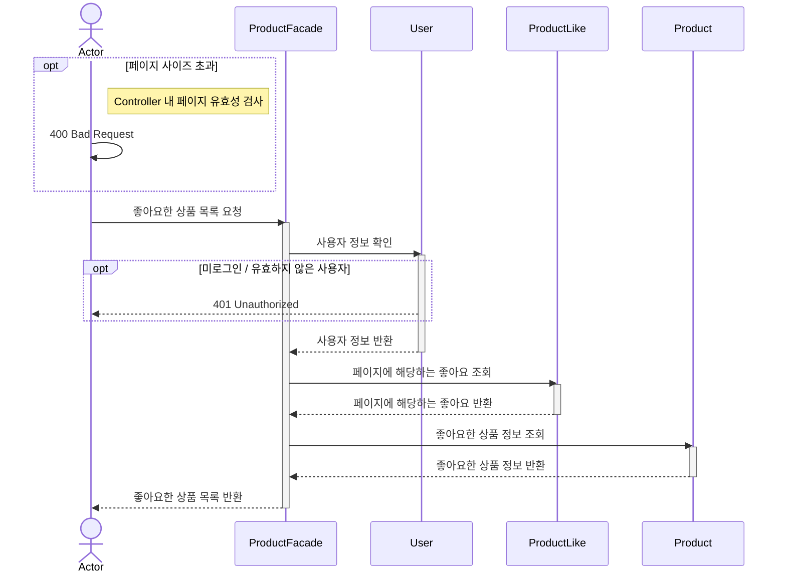

# 주문 생성 API

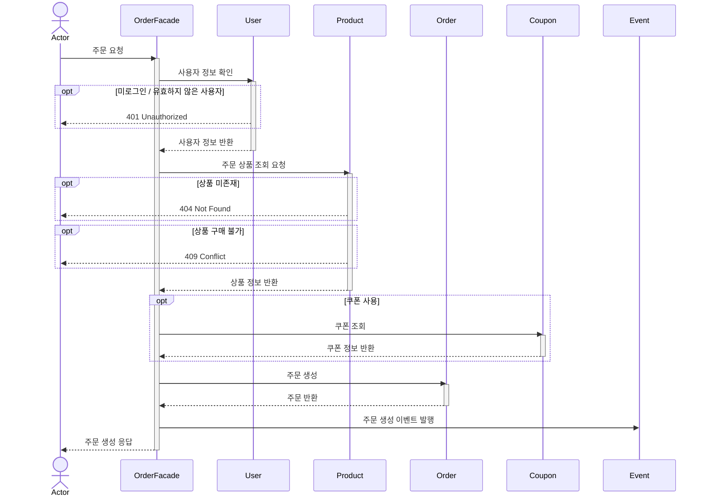

# 결제 시도 요청 API
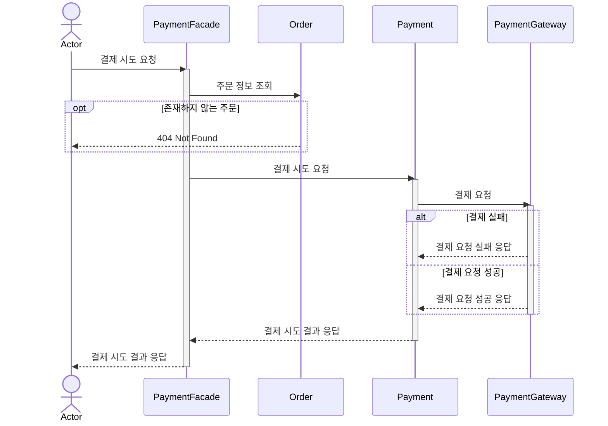

# 결제 콜백 or 스케쥴러
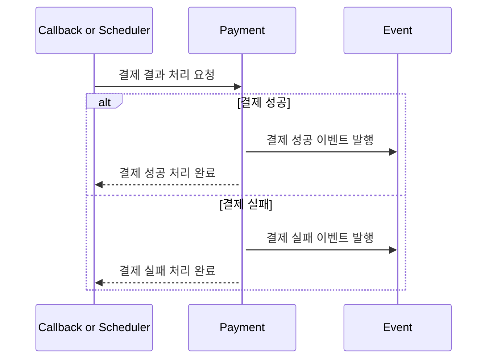

# 유저의 주문 목록 조회

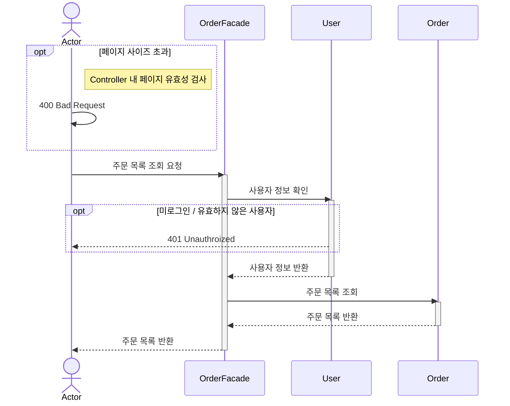

# 단일 주문 상세 조회

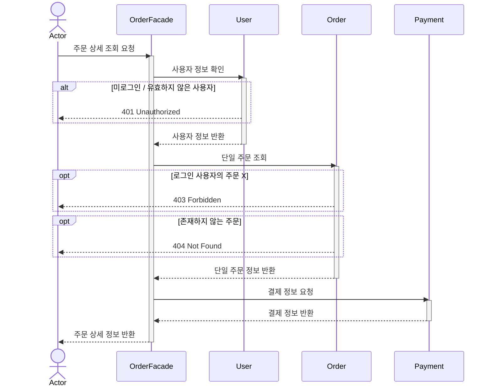